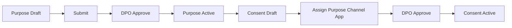
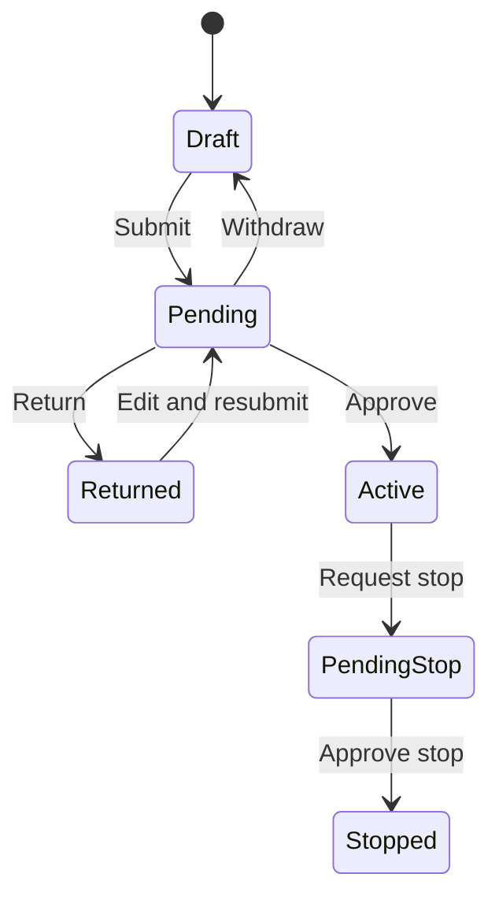

# Phân tích luồng nghiệp vụ xuyên module

## WF-01 Purpose → Consent Configuration

- **Objective:** Tạo nền tảng hợp lệ để một application có thể hỏi consent.
- **Actors:** Nhân viên/Admin, DPO.
- **Trigger/preconditions:** Doanh nghiệp xác định purpose; người tạo có quyền edit.
- **Main flow:** Tạo Purpose draft → điền data/legal basis → submit → đổi role DPO → approve → mở Consent → chọn Purpose active → cấu hình channel/app/duration → submit/approve.
- **Alternate/exception:** Code trùng/sai; thiếu required field; sensitive purpose cảnh báo separate flow; purpose pending không được chọn; self-approval bị chặn.
- **Screens/SRS:** `/purposes`, `/notifications`, `/consents`; FR-001/002, SCR-01, SCR-02, SCR-AP-01.
- **Prototype:** Shared store khiến purpose approved xuất hiện trong Consent form.
- **Expected demo result:** Consent active, có history/audit/notification.
- **Status:** **DEMO COMPLETE**.

## WF-02 Consent → Notice → Banner

- **Objective:** Biến consent configuration thành nội dung minh bạch và UI thu thập.
- **Actors:** Người cấu hình, DPO.
- **Preconditions:** Consent active; purpose/notice dependencies có dữ liệu.
- **Main flow:** Chọn consent → tạo notice từ Published hoặc generated content → nhập VI/EN → submit → DPO chọn material/effective time → publish → tạo/chọn banner version → gắn active consents → preview/check → submit/approve.
- **Alternate:** Thiếu translation/consent/contrast làm khóa submit; scheduled notice chờ hiệu lực; banner active cần new version.
- **Screens/SRS:** `/consents`, `/notices`, `/banners/:code`, Notification; FR-002/003/004/007.
- **Prototype:** Notice và banner version state liên kết; Simulator đọc active banner/Published notice.
- **Expected result:** Banner active hiển thị đúng content/version.
- **Status:** **DEMO COMPLETE**.

## WF-03 Approval → Publish → Active Version

- **Objective:** Minh họa maker-checker và bảo toàn bản active khi revision chờ duyệt.
- **Actors:** Maker và approver khác người.
- **Main flow:** Save draft/revision → submit → notification → Diff/automatic checks → approve hoặc return → active/published → notify maker/audit.
- **Alternate:** Maker withdraw; approver chọn material khác cần lý do; schedule notice; return reason <10 bị chặn.
- **Exception:** Self approval/permission denied.
- **Screens/SRS:** Global Approval Dialog, `/notifications`, object screens; BR-AP-01..09.
- **Prototype:** Hoạt động cho purpose, consent, notice, banner, import. Rule submit chỉ toast; matrix áp dụng ngay.
- **Expected result:** Trạng thái và history thay đổi quan sát được.
- **Status:** **DEMO PARTIAL** do rule/matrix chưa đi cùng lifecycle.

## WF-04 Banner → Accept/Reject → Consent Record

- **Objective:** Giúp team thấy lựa chọn của data subject trở thành evidence và current state.
- **Actors:** Data subject, T3 frontend, CMP simulation.
- **Trigger:** Cookie banner hoặc business function gọi `CMP.require`.
- **Main flow:** Banner/popup active render → user Accept/Reject → `recordDecision` tạo event/receipt metadata/outbox → current state cập nhật → Records/Evidence/Dashboard phản ánh.
- **Alternate:** Dismiss không ghi decision; optional reject vẫn cho function; mandatory dependency reject chặn function.
- **Exception:** CMP-down toggle trả UNKNOWN/fail-closed.
- **Screens/SRS:** Simulator, Records, Evidence, Dashboard; FR-011..014, 027..029, 032.
- **Status:** **DEMO COMPLETE**.

## WF-05 Preference Center → Change/Withdraw

- **Objective:** Cho chủ thể xem và đổi lựa chọn sau lần thu thập đầu.
- **Actors:** Data subject.
- **Preconditions:** Có subject ID và consent states.
- **Main flow:** Mở Preference tab → nhập identity → OTP demo → xem choices → toggle/confirm withdraw hoặc agree again → event/outbox/current state update.
- **Alternate:** Withdraw all marketing; transactional/OTP channel không bị chặn.
- **Exception:** CMP unavailable; anti-enumeration chỉ được mô tả/mô phỏng.
- **Screens/SRS:** Simulator Preference tab, Records/Evidence; FR-019/020/021.
- **Expected result:** WITHDRAWN/ACCEPTED state và delivery event quan sát được.
- **Status:** **DEMO COMPLETE**.

## WF-06 Re-consent → New Decision

- **Objective:** Xin lại consent khi notice thay đổi trọng yếu hoặc state hết hạn.
- **Actors:** DPO, data subject, T3 app.
- **Main flow:** DPO publish notice material → store chuyển accepted subjects sang RE_CONSENT và phát VERSION_CHANGED → lần `CMP.require` sau hiện popup compare/change → subject quyết định mới → current state trở về ACCEPTED/REJECTED với version mới.
- **Alternate:** Non-material publish giữ consent; Simulator có tool đưa state về RE_CONSENT.
- **Screens/SRS:** Notices/Approval, Simulator Form, Records/Evidence; FR-003/004/016.
- **Status:** **DEMO COMPLETE**.

## WF-07 Offline Consent → Evidence

- **Objective:** Hợp nhất quyết định từ SMS/recording/paper với ledger.
- **Actors:** Nhân viên nghiệp vụ, DPO nhận correction notification.
- **Main flow:** Mở Offline → nhập subject/consent/decision/actual time/evidence type/files/version → validate → save → event xuất hiện ở list/Records/Evidence → nếu sai, tạo correction event có reason.
- **Alternate:** Older actual date không thay current state theo rule; tối đa 5 files.
- **Screens/SRS:** `/offline`, `/evidence`, `/records`; FR-017/036.
- **Status:** **DEMO COMPLETE**.

## WF-08 Rights Request → Verification → Processing → Closure

- **Objective:** Xử lý quyền data subject có xác minh, SLA và approval.
- **Actors:** Data subject, operator, DPO, processor.
- **Expected SRS flow:** Submit form → receive request code → verify identity → queue/assign → process → optional one-time extension approval → downstream tasks → DPO approve completion/decline → subject tracks status.
- **Current prototype:** `/rights` chỉ render static rows; không có start point, detail hoặc transition.
- **Screens/SRS:** SCR-22-01/02, 23-01, 24-01/02, 25-01, 26-01; FR-022..026.
- **Missing demo result:** Không thể tạo request rồi đưa nó tới closure.
- **Status:** **MISSING**.

## WF-09 Consent Event → Connector → Delivery Status

- **Objective:** Minh họa withdrawal/acceptance được đẩy sang CRM/CDP/ESP.
- **Actors:** CMP operator, integration operator.
- **Main expected flow:** Decision event → outbox → signed delivery attempt → delivered/retry/failed → manual retry/alert → connector target reflects suppression.
- **Current prototype:** `recordDecision` tạo outbox; Integrations hiển thị event status và có nút retry toast. Connector table static; retry không đổi status; không có event detail/timeline.
- **Screens/SRS:** Simulator, `/integrations`, Notifications; FR-030/031/040.
- **Status:** **DEMO PARTIAL**.

## WF-10 Evidence → Audit → Reporting

- **Objective:** Từ quyết định cá nhân đến bằng chứng, accountability và aggregate insight.
- **Actors:** DPO/Admin/operator.
- **Flow:** Tạo decision → Evidence/Records cập nhật → mở detail ghi audit → export package ghi audit → Dashboard aggregate cùng dataset → Audit screen tra người/thao tác/before-after.
- **Screens/SRS:** Simulator/Offline/Import, Evidence, Audit, Dashboard; FR-036..039.
- **Alternate:** Role Nhân viên bị mask và không export; correction append-only.
- **Status:** **DEMO COMPLETE**.

## WF-11 Cookie Scanner → Classification → Approval

- **Objective:** Phát hiện tracker và kiểm soát việc xếp nhóm Essential.
- **Actors:** Admin/operator, DPO approver.
- **Expected flow:** Create scan → wait/result → classify cookie/tracker → if Essential submit approval → approved catalog affects banner/tag behavior → alerts for leakage.
- **Current prototype:** Integrations chỉ có static cookie result list; không có scan run, classification action hoặc approval.
- **Screens/SRS:** SCR-33-01/02, SCR-AP-01; FR-033.
- **Status:** **MISSING**.

## WF-12 Application Registration → Consent Assignment → Integration Simulation

- **Objective:** Cho một T3 application được định danh, gán consent và dùng CMP đúng scope.
- **Actors:** Admin/integration developer, consent configurator.
- **Expected flow:** Register app → configure property/origins/key/webhook → verify/test → assign consent in Consent form → application calls require/API → events delivered through configured destination.
- **Current prototype:** Apps là mock static; Consent form gán app và Simulator dùng hard-coded app IDs; không có registration/config/test link.
- **Screens/SRS:** SCR-06-01/02, Consent, Simulator, Integrations; FR-006/002/012/030.
- **Status:** **MISSING** như một luồng end-to-end, dù các đoạn giữa có representation.

## Workflow Summary

| Status | Count | Workflows |
|---|---:|---|
| DEMO COMPLETE | 7 | WF-01, 02, 04, 05, 06, 07, 10 |
| DEMO PARTIAL | 2 | WF-03, 09 |
| MISSING | 3 | WF-08, 11, 12 |
