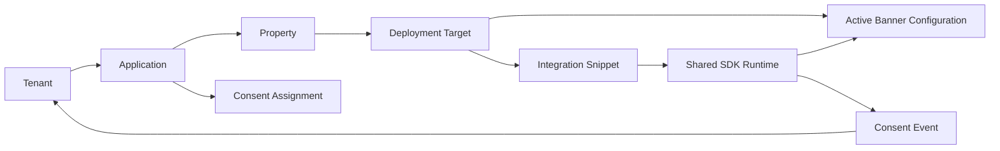

# Đánh giá Multi tenant Application Integration SDK và Deployment cho CMP Prototype

## 1. Kết luận điều hành

Prototype hiện đã có các mắt xích rời của luồng tích hợp: Consent gán Application, Banner có version và approval, Collection Simulator tạo quyết định, Records/Evidence quan sát kết quả, và Integrations hiển thị Application/Event/Connector dạng bảng. Tuy nhiên, người dùng chưa thể đi từ một Application cụ thể tới hướng dẫn cài đặt và kiểm tra deployment. Khoảng trống chính không phải là thiếu thêm một SDK cho mỗi framework, mà là thiếu mô hình liên kết rõ ràng giữa Tenant, Application, Property, configuration đã publish và integration target.

Đề xuất phù hợp nhất là mô hình kết hợp:

- Dùng **shared CMP SDK/runtime theo platform**: một Web SDK, một Android SDK và một iOS SDK; có thể có wrapper cho React Native/Flutter nếu sản phẩm sau này cần.
- Sinh **integration snippet/configuration riêng cho Application + Property + deployment environment**. Snippet chỉ chứa public identifiers, không chứa secret.
- Framework như React, Next.js, Vue và Angular dùng cùng Web runtime; khác nhau chủ yếu ở vị trí cài đặt, lifecycle và code mẫu.
- Banner version không nên được hard-code tùy tiện trong source của khách hàng. Integration target mặc định trỏ tới bản Banner đang Active/Published; prototype có thể cho chọn “Theo bản hiện hành” hoặc pin một version để minh họa.
- Không thêm một sidebar item cho từng bước. Nên nâng cấp `Ứng dụng & tích hợp` thành hub, sau đó dùng Application Detail với các tab Cấu hình, Consent, Giao diện thu thập, Cài đặt SDK, Kiểm thử, Event/Webhook và Audit.

Đây là đề xuất sản phẩm và UX. SRS v1.3 yêu cầu Application registration, origin, SDK behavior, Banner gắn Property, GTM guide, collection, Decision API, Receipt và webhook; SRS chưa yêu cầu trực tiếp một “Integration Code Generator” đa framework. Vì vậy cần phân loại code generator là **IMPLIED BY SRS / PRODUCT ENHANCEMENT**, không phải tự động coi là requirement bắt buộc.

## 2. Đối chiếu với các CMP hiện nay

### 2.1 OneTrust

**Chức năng được tài liệu chính thức xác nhận**

- OneTrust sinh script theo domain; mỗi website được scan có một `data-domain-script` ID riêng. Công cụ cung cấp test script và production script; sau khi publish, thay đổi template/rule/category được đưa tới site đã nhúng script. [Publishing and Implementing Cookie Consent Scripts](https://my.onetrust.com/articles/en_US/Knowledge/UUID-7478d3b4-18eb-3ac0-a6fd-fb7ebff9f8dc)
- OneTrust khuyến nghị thử test script trên staging trước, sau đó dùng production script trên live domain; có Live Preview và hướng dẫn kiểm tra việc blocking. [Implementation Best Practices](https://my.onetrust.com/s/article/UUID-648cbd31-0007-76ab-ca6c-85023ebf83dc?language=en_US)
- Web CMP có JavaScript API và events để mở Banner/Preference Center hoặc phản ứng khi consent thay đổi. [Web CMP JavaScript Methods](https://developer.onetrust.com/onetrust/docs/javascript-api), [Web CMP Events Guide](https://developer.onetrust.com/onetrust/docs/javascript-events-guide)
- OneTrust có native mobile SDK và bridge cho React Native, Flutter, Cordova/Ionic; mobile SDK cung cấp UI Banner/Preference Center hoặc cho phép BYOUI. [Mobile & OTT/CTV SDKs](https://developer.onetrust.com/onetrust/docs/mobile-ctv), [Frameworks](https://developer.onetrust.com/onetrust/docs/frameworks)

**Bài học có thể tham khảo**

- Phân biệt test deployment và production deployment.
- Integration ID gắn với đúng domain/configuration.
- Có SDK API/event riêng cho developer nhưng Banner content vẫn do Console quản lý.
- Mobile cần platform-specific runtime hoặc bridge, còn React/Vue/Angular trên web không nhất thiết cần SDK runtime riêng.

Không suy diễn rằng CMP của chúng ta phải sao chép nguyên mô hình OneTrust domain scanning, CDN hoặc release process.

### 2.2 Cookiebot

**Chức năng được tài liệu chính thức xác nhận**

- Cookiebot cung cấp script trong khu vực “Your scripts”; script chứa `data-cbid`, tức Domain Group ID dùng để tải đúng configuration. CBID là public identifier, không phải secret. [Your CBID or Domain Group ID](https://support.cookiebot.com/hc/en-us/articles/26407199363996-Your-CBID-or-Domain-group-ID-and-where-to-find-it-in-your-Cookiebot-Manager)
- Người dùng copy script vào đầu `<head>`; có lựa chọn automatic blocking hoặc manual blocking. [Manual implementation](https://support.cookiebot.com/hc/en-us/articles/26408320672412-Manually-implementing-Cookiebot-CMP-Cookiebot-Manager), [Automatic cookie blocking](https://support.cookiebot.com/hc/en-us/articles/360009074960-Automatic-cookie-blocking)
- Cookiebot hướng dẫn kiểm tra bằng scan report, browser source/cookies và chế độ incognito; GTM là một phương thức triển khai khác với inline script. [Cookiebot implementation and load guidance](https://support.cookiebot.com/hc/en-us/articles/29979960668956-How-to-improve-your-Cookiebot-CMP-banner-load-time)

**Bài học có thể tham khảo**

- Public configuration ID trong snippet là mô hình hợp lý và phổ biến.
- UI integration nên giải thích rõ blocking mode và vị trí cài script.
- Installation testing cần kiểm tra cả Banner visibility và việc tag/cookie có bị chặn trước consent hay không.

### 2.3 Usercentrics

**Chức năng được tài liệu chính thức xác nhận**

- Apps SDK dùng `SettingsID` hoặc `RulesetID` để xác định configuration. Có thể dùng `latest`, pin một version hoặc dùng `preview` cho draft. [Configure Usercentrics Apps SDK](https://docs.usercentrics.com/cmp_in_app_sdk/latest/getting_started/configure/)
- SDK hỗ trợ iOS, Android và cross-platform như React Native, Flutter; developer khởi tạo SDK bằng SettingsID, chờ trạng thái ready, sau đó quyết định có cần hiển thị Banner hay áp dụng consent đã có. [Getting Started](https://docs.usercentrics.com/cmp_in_app_sdk/latest/integration/intro-collect/)
- SDK cung cấp UI có sẵn hoặc cho phép xây UI riêng; callback trả về consent choices để application áp dụng cho các SDK bên thứ ba. [Collecting Consent](https://docs.usercentrics.com/cmp_in_app_sdk/latest/integration/usercentrics-ui/), [Applying Consent](https://docs.usercentrics.com/cmp_in_app_sdk/latest/integration/intro-apply/)
- Configuration dashboard liên kết App-ID là bundle ID hoặc package name và cho phép nhiều App-ID. [CMP Setup](https://docs.usercentrics.com/cmp_in_app_sdk/latest/overview/config_cmp/)

**Bài học có thể tham khảo**

- Một public configuration ID có thể khởi tạo cùng shared SDK.
- Version pin/preview/current là mô hình UX hữu ích cho deployment và test.
- Mobile integration guide cần khác Web, nhưng không cần một binary SDK riêng cho mỗi tenant.

### 2.4 Didomi

**Chức năng được tài liệu chính thức xác nhận**

- Didomi Web SDK là hosted JavaScript library. Sau khi tạo Consent Notice trong Console, người dùng lấy script tại bước Publish và đặt sớm trong `<head>`. [Didomi Web SDK Getting Started](https://developers.didomi.io/cmp/web-sdk/getting-started)
- Didomi có React component để đơn giản hóa tích hợp, nhưng component vẫn tải configuration từ Didomi Console. Web snippet dùng các identifier như API key/Notice ID cho đúng notice target. [Didomi Web SDK Getting Started](https://developers.didomi.io/cmp/web-sdk/getting-started)
- SDK có API/events để đọc trạng thái, mở UI, accept/reject và phản ứng khi consent thay đổi. [Didomi Web SDK API](https://developers.didomi.io/cmp/web-sdk/reference/api)
- Didomi cung cấp Web, Android, iOS/TV SDK; tài liệu có cách ép Banner hiển thị phục vụ testing ngoài vùng địa lý mục tiêu. [Didomi CMP Introduction](https://developers.didomi.io/cmp/introduction)

**Bài học có thể tham khảo**

- Console → Publish → code snippet là luồng dễ hiểu cho developer.
- Framework integration có thể là wrapper quanh cùng Web SDK.
- Test mode cần cho phép buộc hiển thị Banner mà không làm thay đổi configuration production.

### 2.5 So sánh ngắn

| Sản phẩm | Configuration selector | Web integration | Mobile | Testing/deployment |
|---|---|---|---|---|
| OneTrust | Domain-specific script ID | CDN test/production script, JS API/events | Native SDK + framework bridges | Staging/test script, production script, live preview |
| Cookiebot | Public Domain Group ID/CBID | Script tag; auto/manual blocking; GTM | Không dùng làm mẫu chính cho mobile trong phân tích này | Scan report và browser checks |
| Usercentrics | SettingsID/RulesetID, optional version | Shared configuration concept | iOS, Android, Flutter, React Native | Latest, pinned version, preview |
| Didomi | Notice/configuration identifiers | Hosted SDK script; React wrapper | Android/iOS/TV SDK | Publish flow, force-show test option |

Không có bằng chứng cho thấy mỗi sản phẩm đều cung cấp đúng cùng một màn “Application Integration Code Generator” như đề xuất. Điểm chung đáng tin cậy là shared runtime + public configuration identifier + publish/install/test workflow.

## 3. Mô hình Tenant Application Property Banner

### 3.1 Mô hình đề xuất



### 3.2 Ý nghĩa các object

| Object | Mục đích | Identifier public |
|---|---|---|
| Tenant | Ranh giới ownership và isolation | `tenant_public_id` dạng opaque, nếu thực sự cần trong snippet |
| Application | Hệ thống tích hợp CMP: Web, Mobile hoặc Backend | `app_id` theo UC-06 |
| Property | Digital property của Organization: domain, mobile property hoặc channel | `property_id` |
| Consent Assignment | Danh sách Consent mà Application được phép gọi | Không cần secret |
| Banner Configuration | Giao diện/version đã được phê duyệt | `banner_config_id`, active version |
| Deployment Target | Binding giữa app + property + platform + environment + config | `deployment_id` hoặc `config_id` public |
| SDK runtime | Thư viện thực thi dùng chung theo platform | URL/package version |
| Integration snippet | Cấu hình cài SDK tại application | Public IDs, environment và runtime options |

Nên để snippet chỉ cần một `deployment_id` opaque nếu runtime có thể resolve toàn bộ tenant/application/property/config từ ID này. Trong prototype có thể hiển thị các ID riêng để người xem hiểu mapping, nhưng sản phẩm thật nên giảm số tham số client có thể lắp ghép sai.

### 3.3 Application và Property

Theo UC-06, Property phải tồn tại trước khi tạo Application. Một Application thuộc một Tenant và một Property chính; nếu cần nhiều domain/origin cho cùng application, chúng được quản lý như allowed origins hoặc deployment environments. Cần BA xác nhận liệu một Application có được gán nhiều Property hay không. SRS hiện mô tả chọn một Property ở SCR-06-02.

## 4. Đánh giá Prototype hiện tại

### 4.1 Màn hình/chức năng đã có

| Thành phần | Hiện trạng | Đánh giá |
|---|---|---|
| `/consents` | Consent có danh sách Application assignment | Có nền tảng liên kết nhưng app là mock global |
| `/banners` và `/banners/:code` | Banner list/editor, version và approval | Có thể tái sử dụng; cần binding rõ với Property/Application/deployment target |
| `/integrations` tab Application | Bảng tên, app id, Property, origin, consent assignment | UI ONLY; không create/edit/detail/test |
| `/integrations` tab Event | Event từ Simulator, trạng thái delivery | DEMO PARTIAL; quan sát được nhưng retry còn mô phỏng |
| `/integrations` tab Connector/Scanner | Bảng static | UI ONLY |
| `/simulator` | Cookie/Form/Preference/API simulation, Accept/Reject và tạo Records/Evidence | Có thể làm installation sandbox nhưng chưa nhận deployment configuration cụ thể |
| `/records`, `/evidence` | Quan sát quyết định và evidence | Có thể tái sử dụng cho verification sau cài đặt |
| `/rules` Matrix | Matrix theo Application và approval | Có thể cung cấp runtime dependency đã duyệt |
| `/users` | RBAC mock | Cần tenant-scoped permission trước khi multi-tenant |

### 4.2 Gap quan trọng

- Chưa đăng ký Application theo UC-06.
- Chưa có Organization/Brand/Property management theo UC-08.
- Chưa có Application Detail.
- Chưa có environment/deployment target.
- Chưa có lựa chọn platform/framework và installation guide.
- Chưa có generated code hoặc copy action.
- Chưa có mapping Banner Active vào integration target.
- Chưa có deployment status hoặc installation checklist.
- Simulator không được khởi tạo từ một deployment target cụ thể.
- App/Property/config/event chưa tenant-scoped.

## 5. Danh sách màn hình cần bổ sung hoặc cải thiện

### 5.1 Đề xuất tối thiểu

| Screen/Tab | Hành động | Actor | Phân loại | Lý do |
|---|---|---|---|---|
| Organization & Property | Tạo/cập nhật Brand, Property, language | Tenant Admin | REQUIRED BY SRS, UC-08 | Property là tiền điều kiện UC-06/07 |
| Application List | Đăng ký, xem status/type/property | Tenant Admin; DPO/Staff xem | REQUIRED BY SRS, SCR-06-01 | Hiện chỉ có bảng static |
| Application Detail — Overview | Tên, type, app_id, client_id, state | Tenant Admin | REQUIRED BY SRS, SCR-06-02 | Điểm vào cho toàn bộ integration lifecycle |
| Application Detail — Properties & Security | Property, origins, S2S, public key, JWE, unavailable behavior | Tenant Admin | REQUIRED BY SRS, UC-06 | Không hiển thị private key/secret |
| Application Detail — Consent Assignment | Xem/đi tới consent được gán | Admin; Staff theo quyền | REQUIRED BY SRS/UC-02/06 AF-04 | Liên kết configuration với app |
| Application Detail — Collection UI | Chọn Banner/Popup Active phù hợp Property | Admin/Staff | IMPLIED BY SRS | SRS gắn Banner với Property, chưa mô tả binding UI riêng |
| Application Detail — SDK & Installation | Platform/framework, snippet, install guide, copy | Developer/Tenant Admin | IMPLIED BY SRS + PRODUCT ENHANCEMENT | Kết nối UC-06, UC-07, UC-32 thành thao tác thực tế |
| Application Detail — Test Installation | Preview/sandbox, configuration checks, event checks | Developer/Tenant Admin | PRODUCT ENHANCEMENT + DEMO UTILITY | Làm workflow demo quan sát được |
| Application Detail — Events & Webhooks | Test webhook, delivery history | Tenant Admin; others view | REQUIRED BY SRS, UC-06/30 | Có thể reuse tab event hiện tại |
| Application Detail — Audit | Thay đổi application/deployment | Tenant Admin/DPO view | REQUIRED BY SRS | UC-06 yêu cầu audit |
| Installation Sandbox | Render Banner theo deployment target; Accept/Reject | Developer/demo presenter | DEMO UTILITY | Reuse Simulator; không cần màn runtime thật |

### 5.2 Không nên tạo màn hình riêng

- Không tạo một màn cho mỗi framework React/Vue/Angular. Đây là các tab/code samples trong SDK & Installation.
- Không tạo màn riêng cho “Copy code”; đây là action trong code panel.
- Không tạo màn riêng cho Banner deployment nếu có thể đặt tại Application Detail và Banner detail bằng cross-link.
- Không tạo một “SDK Management” cho mỗi tenant. Runtime SDK là platform capability, không phải tenant-owned content.

### 5.3 Tenant Admin Platform Admin và Developer

| Actor | Phạm vi phù hợp |
|---|---|
| Tenant Admin | Organization/Property, Application registration, origin, public key, webhook, deployment target, integration code, test installation |
| Staff | Consent/Notice/Banner configuration và assignment theo permission; không quản lý secret/config kỹ thuật mặc định |
| DPO | Xem Application; approve Banner/config tuân thủ; không cần sửa kỹ thuật UC-06 |
| Developer Integrator | Xem/copy installation guide, IDs public, sample code, run test; không thấy secret hoặc tenant administration |
| Platform Admin | Provision/suspend tenant, quản lý shared SDK catalog/CDN release và platform health nếu sản phẩm cần; không mặc định xem Consent Records/Evidence của tenant |

“Developer Integrator” chưa phải role trong SRS v1.3. Nếu cần role riêng thay vì Tenant Admin thực hiện, đây là **NEED BA/PO CONFIRMATION**.

## 6. Đề xuất sidebar và tab

### Sidebar

- Giữ một mục **Ứng dụng & tích hợp** trong nhóm Hệ thống.
- Không đưa Integration Code Generator thành sidebar item độc lập.
- Khi có multi-tenant, hiển thị Tenant switcher ở header/sidebar và tenant badge trên Application Detail.

### Application Detail tabs

1. **Tổng quan** — identity, type, status, Property.
2. **Cấu hình kỹ thuật** — origins, S2S, public key, JWE, failure behavior.
3. **Consent & giao diện thu thập** — assigned Consent và Active Banner/Popup.
4. **SDK & cài đặt** — platform/framework, generated snippet, install steps.
5. **Kiểm thử** — checklist, preview/sandbox, test decision.
6. **Event & webhook** — test webhook, delivery history.
7. **Nhật ký** — audit changes.

Connector và Cookie Scanner có thể vẫn là tabs cấp hub vì chúng không nhất thiết thuộc một Application duy nhất. Application Detail chỉ hiển thị liên kết hoặc filtered views liên quan.

## 7. Shared SDK và Application specific Script

### 7.1 Làm rõ thuật ngữ

| Thuật ngữ | Ý nghĩa |
|---|---|
| SDK runtime | Code thực thi dùng chung: tải configuration, render UI, ghi decision, phát event hoặc chặn tag |
| Generated integration snippet | Đoạn cấu hình/cài đặt ghép runtime với đúng deployment target |
| Application configuration ID | Public opaque ID xác định Application/deployment configuration |
| Banner configuration/version | Nội dung/giao diện đã duyệt mà runtime cần tải |
| Framework-specific guide | Hướng dẫn đặt shared runtime vào lifecycle của HTML, React, Next.js, Vue hoặc Angular |

Framework guide không đồng nghĩa với SDK runtime riêng.

### 7.2 Option A Shared CMP SDK

**Mô hình**

```html
<script
  src="https://cdn.cmp.example/sdk/web/v1/cmp.js"
  data-config-id="cfg_public_7Q2K9M"
  data-environment="production">
</script>
```

**Ưu điểm**

- Một runtime để sửa lỗi, nâng cấp và tối ưu cache.
- Dễ mở rộng nhiều tenant/application.
- Cùng behavior giữa khách hàng; giảm divergence.
- Snippet nhỏ và dễ copy.
- Configuration đổi sau approval mà không cần đổi source nếu target dùng current active version.

**Hạn chế/rủi ro**

- Runtime phải resolve đúng tenant/application/property từ identifier.
- Một lỗi shared SDK có blast radius lớn hơn.
- Cần versioning/backward compatibility rõ ràng.
- Cần cache invalidation khi publish configuration mới.

### 7.3 Option B Application specific Script

**Mô hình**

- Mỗi Application nhận một URL/script/package build riêng chứa configuration cố định hoặc code tùy biến.

**Ưu điểm**

- Dễ hình dung isolation theo URL riêng.
- Có thể pin behavior/configuration độc lập.
- Có thể tối ưu bundle cho từng app.

**Hạn chế/rủi ro**

- Số artifact tăng theo tenant × application × environment.
- Deployment, cache, rollback và security patch phức tạp.
- Dễ phân mảnh runtime và gây khó support.
- “Script riêng” vẫn không thay thế server-side authorization; ID/URL public có thể bị copy.

### 7.4 Khuyến nghị

Chọn **Option A cho runtime**, kết hợp **application-specific generated snippet**. Đây không phải thỏa hiệp mơ hồ: runtime binary dùng chung, nhưng `config_id/deployment_id` và guide được sinh riêng cho đúng target.

- Web: một shared Web SDK; HTML/React/Next/Vue/Angular là guide/wrapper.
- Android: một shared Android SDK package; application khởi tạo bằng public config ID.
- iOS: một shared iOS SDK package; application khởi tạo bằng public config ID.
- Không tạo SDK theo từng ngôn ngữ backend trong phạm vi collection UI. Backend dùng Decision API/S2S client theo UC-27.

## 8. Thiết kế UX Integration Code Generator

### 8.1 Entry point

- Từ Application Detail: nút **Thiết lập tích hợp**.
- Từ Banner Active: **Sử dụng trong ứng dụng** mở Application picker đã lọc theo Property.
- Từ Consent: link tới Application assignment; không sinh code trực tiếp từ Consent vì runtime cần đầy đủ deployment context.

### 8.2 Wizard hoặc tab flow

1. Chọn Application.
2. Xác nhận Property và environment: Development, Staging hoặc Production.
3. Chọn platform: Web, Android, iOS.
4. Web mới hiển thị framework: HTML/JavaScript, React, Next.js, Vue, Angular, GTM.
5. Chọn collection UI phù hợp: Active Banner/Popup của Property.
6. Xem consent assignments và matrix version đang hiệu lực ở chế độ read-only.
7. Sinh snippet và checklist.
8. Copy code hoặc mở Installation Sandbox.

### 8.3 Nội dung code panel

- Runtime/package name và version.
- Public `deployment_id/config_id`.
- Application và Property được resolve ra để người dùng xác nhận.
- Active Banner config và version hiện hành.
- Nút Copy.
- Cảnh báo không đưa client secret, webhook secret, private key vào frontend.
- Test mode flag chỉ có tác dụng trong Sandbox/prototype.

### 8.4 Framework guides

| Framework | Điểm khác biệt cần hướng dẫn |
|---|---|
| HTML/JavaScript | Đặt bootstrap script sớm trong `<head>`; thứ tự với tag cần consent |
| React | Load một lần ở root; đăng ký event listener; cleanup; tránh chèn lại theo render |
| Next.js | Phân biệt root layout/client component và SSR; chỉ gọi browser API ở client |
| Vue | Khởi tạo ở app entry/plugin; expose composable/event state nếu cần |
| Angular | Khởi tạo qua service/app initializer; observable cho consent changes |
| GTM | Dùng template/Consent Mode; giải thích khác inline auto-blocking |
| Android | Cài package, initialize bằng config ID, chờ ready, show UI và apply decision |
| iOS | Cài package, initialize bằng config ID, chờ ready, present UI và apply decision |

Code trong Prototype phải gắn nhãn **Mô phỏng — chưa có SDK/runtime thật**.

### 8.5 Deployment status

Prototype nên mô phỏng các trạng thái:

- Chưa cấu hình.
- Snippet đã tạo.
- Chờ cài đặt.
- Đã phát hiện SDK mô phỏng.
- Cấu hình không khớp Property/origin.
- Banner Active đã tải.
- Decision test đã ghi nhận.

Không nên gọi trạng thái “Production Ready” vì prototype không thực hiện network/security/runtime checks thật.

## 9. Multi tenant isolation

### 9.1 Nguyên tắc

1. `deployment_id` phải resolve tới đúng một tuple bất biến về ownership: `tenant_id + application_id + property_id + environment`.
2. Banner được chọn phải thuộc cùng tenant và Property với deployment target.
3. Consent assignment chỉ tham chiếu Consent cùng tenant.
4. SDK không được chấp nhận `tenant_id`, `app_id`, `property_id`, `banner_id` do client tự ghép mà không kiểm tra binding.
5. Event ghi tenant/application/property từ server-resolved deployment context, không tin hoàn toàn payload client.
6. Records/Evidence query luôn tenant-scoped.
7. Public snippet không chứa client secret, webhook HMAC secret, private key hoặc S2S credential.
8. Inactive Application hoặc origin không hợp lệ bị từ chối theo UC-06.
9. Chỉ Banner version Active/Published được dùng ở production target; preview target có thể trỏ draft nhưng phải gắn nhãn test.

### 9.2 Mô phỏng bằng Zustand

```ts
interface DeploymentTarget {
  id: string
  tenantId: string
  applicationId: string
  propertyId: string
  platform: "WEB" | "ANDROID" | "IOS"
  environment: "DEVELOPMENT" | "STAGING" | "PRODUCTION"
  bannerConfigId: string
  versionMode: "CURRENT_ACTIVE" | "PINNED"
  pinnedVersion?: number
  status: string
}
```

Prototype cần các selector/action:

- `getDeploymentTarget(currentTenantId, deploymentId)`.
- `resolveActiveBanner(target)` chỉ trả config cùng tenant/property.
- `simulateInstall(target, originOrBundleId)` kiểm tra target binding.
- `recordDecision` tự thêm tenant/application/property từ target đã resolve.
- Khi đổi tenant, đóng code generator/sandbox đang mở của tenant cũ.

Nên có negative demo: copy `deployment_id` của Tenant A sang Tenant B và hiển thị `CONFIG_NOT_FOUND_OR_NOT_AUTHORIZED`, không tải Banner A.

## 10. End to end demo workflow

| Bước | Actor | Input/UI action | State transition | Expected result | SRS | Screen |
|---:|---|---|---|---|---|---|
| 1 | Platform operator | Provision Tenant | Tenant available | Tenant Admin truy cập workspace | UC-08, một phần ngoài self-service SRS | Proposed tenant context |
| 2 | Tenant Admin | Tạo Brand/Property | Property created | `retail.abc.vn` thuộc ABC Retail | UC-08 | Proposed Organization & Property |
| 3 | Tenant Admin | Đăng ký Web Application | Inactive app created, cấp app_id | App thuộc đúng tenant/property | UC-06 | Proposed Application List/Detail |
| 4 | Tenant Admin | Khai origin và chuyển Active | Inactive → Active | Application đủ điều kiện tích hợp | UC-06 | Application Detail |
| 5 | Staff/Admin | Gán Consent cho Application | Assignment updated | App chỉ gọi consent được gán | UC-02, UC-06 AF-04 | Existing Consent + App Detail |
| 6 | Staff/Admin | Tạo/sửa Banner cho Property | Draft → Pending | Active Banner cũ giữ hiệu lực | UC-07 | Existing Banner Editor |
| 7 | DPO | Approve Banner | Pending → Active | Config mới sẵn sàng cho SDK | UC-07, common approval | Existing Approval/Banner |
| 8 | Tenant Admin/Developer | Chọn platform/framework/config | Deployment target created | Sinh public config ID/snippet | IMPLIED BY UC-06/07/32 | Proposed SDK & Installation |
| 9 | Developer | Copy code, mở test sandbox | Waiting → Detected mock | Hiển thị app/property/config resolved | PRODUCT ENHANCEMENT | Proposed Test Installation |
| 10 | Developer/demo user | Force fresh session | Banner displayed | Đúng Active Banner của Property | UC-07/11 | Reused Simulator |
| 11 | Data Subject | Accept hoặc Reject | Consent event written | Record/evidence/receipt mock xuất hiện | UC-11..14, UC-28 | Simulator |
| 12 | Tenant Admin/DPO | Mở Records/Evidence | Read tenant-scoped event | Quan sát đúng app/property/version | UC-36/37 | Existing Records/Evidence |
| 13 | Tenant Admin | Xem Event/Webhook | PENDING → delivery mock | Quan sát downstream event | UC-30 | Existing Integrations Event |

## 11. SRS traceability và phân loại đề xuất

| Requirement | Nội dung liên quan | Coverage hiện tại | Đề xuất | Phân loại |
|---|---|---|---|---|
| SRS-FR-006 / UC-06 | App list/detail, Property, app_id, origins, keys, webhook, test, Active | Static App table | Application List/Detail và interactions | REQUIRED BY SRS |
| SRS-FR-007 / UC-07 | Banner/Popup gắn Property, approval, SDK nhận config Active | Banner editor/approval có; binding chưa rõ | Collection UI tab và deployment binding | REQUIRED/IMPLIED BY SRS |
| SRS-FR-008 / UC-08 | Organization → Brand → Property, RBAC | User/RBAC partial; thiếu org tree | Property management và tenant context | REQUIRED BY SRS |
| SRS-FR-011 / UC-11 | Cookie Banner choices | Simulator có | Sandbox phải dùng selected deployment config | REQUIRED behavior, demo integration IMPLIED |
| SRS-FR-012 / UC-12 | Accept qua `CMP.require` | Simulator có | Reuse, thêm target context | REQUIRED behavior |
| SRS-FR-013 / UC-13 | Reject và Matrix impact | Simulator + Matrix có | Reuse, verify active matrix | REQUIRED behavior |
| SRS-FR-014 / UC-14 | Sensitive consent | Simulator có | Mobile/Web guide gọi đúng flow | REQUIRED behavior; guide IMPLIED |
| SRS-FR-027 / UC-27 | Decision API | Simulator API có | Server integration guide/tab | REQUIRED API; generator PRODUCT ENHANCEMENT |
| SRS-FR-028 / UC-28 | Consent Receipt | Evidence mock có | Hiển thị receipt result sau test | REQUIRED behavior |
| SRS-FR-030 / UC-30 | Event/webhook, test/history | Event list partial | App-filtered Event/Webhook tab | REQUIRED BY SRS |
| SRS-FR-031 / UC-31 | Connector | Static table | Giữ connector ở hub; không đưa vào Prompt integration đầu tiên | REQUIRED BY SRS nhưng scope sau |
| SRS-FR-032 / UC-32 | SDK tag control, GTM template và install guide | Cookie simulator | GTM guide và installation checks | REQUIRED BY SRS |
| Không có ID trực tiếp | Framework selector/code generator | Chưa có | SDK & Installation tab | PRODUCT ENHANCEMENT / IMPLIED BY SRS |
| Không có ID trực tiếp | Deployment status | Chưa có | Mock detection/checklist | DEMO UTILITY |
| Không có ID trực tiếp | Developer role riêng | Chưa có | Optional role/persona | NEED BA/PO CONFIRMATION |

## 12. Các câu hỏi BA PO cần quyết định

| ID | Quyết định cần chốt | Options | Khuyến nghị cho Prototype | Tác động |
|---|---|---|---|---|
| INT-01 | Application thuộc một hay nhiều Property? | Một / Nhiều | Một Property chính theo UC-06 | Data model và picker |
| INT-02 | Deployment target có là object chính thức không? | Có / Chỉ generate tức thời | Có object mock | Status, audit, test continuity |
| INT-03 | Public selector duy nhất là gì? | app_id / config_id / deployment_id | `deployment_id` opaque | Giảm lắp ghép sai và isolation |
| INT-04 | Banner binding đặt ở đâu? | App / Property / Deployment | Property + deployment override có kiểm soát | UC-07 và reuse config |
| INT-05 | Version mode | Current Active / Pinned / Cả hai | Current Active mặc định; pinned cho staging demo | Rollout và rollback |
| INT-06 | Environment | Không có / Dev-Staging-Prod | Ba environment mock | Test/prod separation |
| INT-07 | Developer là role mới? | Role / Permission bundle / Admin persona | Permission bundle hoặc demo persona trước | RBAC/SRS change |
| INT-08 | Mobile property identity | Bundle ID/package name / Property riêng | Property + platform identifiers | Android/iOS validation |
| INT-09 | Web framework scope | Chỉ HTML+React / 5 framework / GTM | HTML, React, Next.js và GTM trước | Khối lượng UX/content |
| INT-10 | Test có ghi event thật vào demo ledger? | Có gắn test flag / Không | Có `environment=TEST`, lọc được | Records/Evidence clarity |
| INT-11 | Test subject có xuất hiện ở dashboard? | Có / Không | Không mặc định; có filter Test | Tránh méo KPI demo |
| INT-12 | Tenant public ID có lộ trong snippet? | Có / Chỉ deployment ID | Chỉ deployment ID | Isolation và UX |
| INT-13 | Backend integration guide | Cùng màn / Tab riêng | Tab Decision API trong SDK & Installation | UC-27 clarity |
| INT-14 | Origin check trong prototype | Chỉ text / Interactive negative test | Interactive negative test | Chứng minh UC-06 isolation |
| INT-15 | Application Registration thuộc phase nào? | Multi-tenant core / Integration phase | Multi-tenant core trước code generator | Dependency sequencing |

## 13. Phạm vi triển khai Prototype đề xuất

### Phase 1 — Foundation bắt buộc

- Tenant context và tenant-scoped store.
- Organization/Brand/Property mock.
- Application List/Detail có create/edit/Active/Inactive.
- Consent assignment và Banner binding kiểm tra cùng tenant/property.
- Không làm code generator trước khi foundation này ổn định.

### Phase 2 — Integration Setup demo

- Application Detail tabs.
- Deployment target mock.
- Platform/framework selector.
- Generated snippet và copy action.
- Installation checklist.
- Nhãn rõ “Mô phỏng — chưa có SDK runtime thật”.

### Phase 3 — Installation Sandbox

- Khởi tạo Simulator từ deployment target.
- Render đúng Active Banner.
- Accept/Reject qua action hiện có.
- Deep links tới Records/Evidence/Event.
- Negative isolation tests: wrong tenant, property, origin, inactive app.

### Phase 4 — Các integration workflow khác

- Webhook test/detail/retry.
- Connector configuration.
- Cookie Scanner/classification.
- GTM tag-control diagnostics.

Không nên triển khai Phase 4 chỉ để hoàn thiện code generator. Đây là các workflow SRS riêng và cần scope độc lập.

## 14. Acceptance criteria cho Integration Prototype

1. Tenant Admin chọn đúng Application và Property trước khi sinh snippet.
2. Chỉ Banner Active/Published cùng tenant/property được chọn cho production target.
3. Web framework selector thay đổi guide, không tạo runtime SDK khác nhau giả tạo.
4. Snippet không chứa secret/private key.
5. Copy action có kết quả quan sát được.
6. Sandbox hiển thị đúng app/property/config/version đã chọn.
7. Accept/Reject sử dụng action hiện có và tạo Records/Evidence đúng tenant.
8. Pending Banner revision không được deployment production sử dụng.
9. Inactive Application hoặc wrong origin bị mô phỏng từ chối.
10. Deployment ID của Tenant A không tải configuration trong Tenant B.
11. Test events được gắn nhãn và có thể lọc khỏi KPI production.
12. Mọi chức năng runtime/security thật được ghi rõ là mô phỏng.

